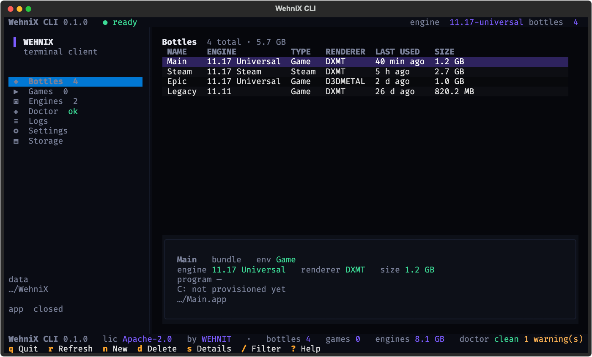

<p align="center">
  
</p>

<p align="center">
  <a href="https://github.com/wehnnit/WehniX-CLI/releases"></a>
  
  
  
  
  
</p>

<h1 align="center">WehniX CLI</h1>

<p align="center">
  The same bottles, the same engines, no window.<br>
  A terminal client for <a href="https://github.com/wehnnit/WehniX">WehniX</a> — Apache-2.0, no account, local only.
</p>

---

WehniX CLI reads the data folder the WehniX desktop app already owns
(`~/Library/Application Support/WehniX`) and gives you a keyboard-first view of
it: bottles, the engines behind them, the Steam games installed inside them, a
doctor that explains what is wrong, and the app log without opening the app.

It is a second front end, not a second app. Create a bottle in the terminal and
the window shows it; delete one in the window and the terminal stops listing it.
There is no sign-in, no sync, no telemetry, and nothing is downloaded.

## Install

```sh
curl -fsSL https://raw.githubusercontent.com/wehnnit/WehniX-CLI/main/scripts/install.sh | bash
```

That creates a private virtualenv in `~/.local/share/wehniX-cli`, puts a
`WehniX` command in `~/.local/bin`, and adds that folder to your shell's `PATH`
if it is missing. No `sudo`, and it never touches the desktop app's data.

Any of these also work:

```sh
pipx install git+https://github.com/wehnnit/WehniX-CLI.git
uv tool install git+https://github.com/wehnnit/WehniX-CLI.git
python3 -m pip install --user git+https://github.com/wehnnit/WehniX-CLI.git
```

The command answers to `WehniX`, `wehniX`, `wehnix` and `Wehnix`; the installer
creates every spelling the filesystem can tell apart.

Requires macOS 13 or newer and Python 3.9+. The desktop app must have run at
least once, because this CLI has no setup of its own — it reads the app's folder
and refuses to invent one.

## Quick start

```sh
WehniX                 # the interface
WehniX list            # bottles, one line each
WehniX list --json     # the same, for scripts
WehniX doctor          # is this machine ready to run a bottle?
WehniX logs -n 50      # the tail of wehniX.log
```

## Keys

| Key | What it does |
| --- | --- |
| `↑` `↓` / `j` `k` | move through the list |
| `enter` | reveal the selection in Finder |
| `/` | filter bottles by name, engine or renderer (`escape` clears) |
| `l` | launch the selected bottle |
| `s` | bottle details, read from the bottle's own plist |
| `n` | new bottle from an installed engine |
| `d` | delete a bottle — it moves to the Trash |
| `t` | pause or follow the log |
| `r` | refresh everything |
| `o` | open the WehniX window |
| `1` … `7` | jump to a section |
| `ctrl+p` | command palette |
| `?` | the key list |
| `q` | quit |

Every action is also in the command palette, so nothing needs memorising.
[`docs/cli-commands.md`](docs/cli-commands.md) lists every key and subcommand,
including JSON shapes and exit codes.

## How it works

**It reads the app's files, not a copy of them.** The CLI understands the exact
shapes the desktop writes:

| Path | What the CLI does with it |
| --- | --- |
| `config.json` | reads `settings.engine_version`, `graphics_backend`, `auto_check_updates`; can change only those three |
| `bottles.json` | reads records keyed by `unique_id`, `id`, `path` or bundle name — all four spellings the two front ends have used |
| `bottles/<unique_id>/<Name>.app` | reads `Info.plist` for the engine version, edition and environment type |
| `Engine/*.zip` | identifies the build by name and reports whether it can create bottles |
| `logs/wehniX.log` | tails it, no parsing of private data |

**Reads are read-only and cheap.** One snapshot per refresh; `du` over a bottle
and the Steam-manifest scan run in worker threads so the interface never blocks.
The log follows on a timer only while the Logs section is open.

**Writes are few, guarded, and reversible.**

* Every write first checks whether the desktop app is open. If it is, the CLI
  refuses instead of racing it — the app rewrites `config.json` while running.
* `n` stages the engine archive in `bottles/.creating-<uuid>`, validates the app
  bundle it produced, brands the plist the way the desktop does, ad-hoc signs
  it, and only then moves it to `bottles/<uuid>/<Name>.app`. A failure removes
  the staging folder and nothing else. No record is written until the bundle
  passes verification.
* `d` moves the bottle to the Trash and drops exactly its record. Names,
  records and files belonging to other bottles stay byte-identical.
* Settings changes use optimistic concurrency: if `config.json` changed between
  the read and the write, the write is refused with "refresh and try again".
* Archive extraction validates every member and every symlink target, so an
  archive cannot write outside its staging folder.

**What it deliberately does not do.** No account, no cloud, no playtime
upload, no Epic login, no Steam launch, no engine download, no silent updater,
and no deleting anything the user did not select. Epic titles are managed by the
desktop app and are not guessed at from a cache. Those limits are in
[Limitations](#limitations) rather than hidden behind a button that fails.

## How the code works

```text
src/wehnix_cli/
├── contract.py    desktop rules: engine table, bottle types, env normalisation,
│                  name sanitising, record shape, allowed settings
├── models.py      dataclasses only (Bottle, EngineArtifact, Game, Check, Snapshot)
├── state.py       reads config/bottles/Info.plist/manifests; atomic writes;
│                  prepare_state_dir; the app-running guard
├── actions.py     reveal, launch, create, delete, set_setting, tail_log;
│                  archive extraction with symlink and traversal validation
├── doctor.py      the health checks behind the Doctor section and `doctor`
├── cli.py         argparse subcommands, JSON output, exit codes
└── tui/
    ├── app.py     Textual app: views, modals, bindings, workers
    └── style.py   the brand palette and stylesheet
```

The flow is one direction, which is why the views never drift out of sync:

```text
files on disk ──► state.read_snapshot() ──► Snapshot ──► views draw it
                                   │
user action ──► actions.<verb>() ───┘  (guard, stage, validate, write)
                                   │
                                   └──► refresh_all() reads again
```

Views hold no logic of their own: they are handed a `Snapshot` and render it.
Anything that changes state goes through `actions.py`, so the app-running guard,
staging and validation cannot be skipped by a code path that forgot them.
`contract.py` is the single copy of the desktop's rules — engine support,
bottle types, environment normalisation — so the CLI cannot offer a bottle the
window would refuse, or accept an environment the engine cannot run.

Every ported rule names its source, for example:

```python
# Copied from wehnix_app.py :: bottle_types_for_engine
def bottle_types_for_engine(version): ...
```

## Development

```sh
python3 -m venv .venv
. .venv/bin/activate
pip install -e ".[dev]"

pytest                                  # 59 tests, no network, no real data
WEHNIX_CLI_STATE_DIR="$PWD/tests/fixtures/state" WehniX
python scripts/make_screenshot.py       # regenerate docs/cli.svg
```

Tests copy `tests/fixtures/state` into a temporary folder and redirect `HOME`,
so the suite never reads or writes `~/Library/Application Support/WehniX` and
never sends anything to the real Trash.

## Limitations

* **No account features.** There is no sign-in, so playtime, cloud sync and the
  dashboard are not here. That is the point of this client, not a gap to fill.
* **Epic is read-only elsewhere.** Epic environments, logins and launches are
  the desktop app's job. `WehniX games` lists Steam libraries only.
* **Bottle launch settings are read-only.** The launch program, renderer and
  sync mode are written by the app into the engine's own config; the CLI shows
  them (`s`) and leaves editing to the app rather than hand-editing an engine
  contract it cannot verify.
* **Creation is local.** It needs an engine archive already in `Engine/`; it
  never downloads one, and it reports a failed `codesign` instead of hiding it.
* **Beta.** The interface and the JSON shapes may still change between 0.x
  releases.

## License

Apache-2.0. See [LICENSE](LICENSE), [NOTICE](NOTICE),
[TRADEMARKS.md](TRADEMARKS.md) and
[THIRD_PARTY_NOTICES.md](THIRD_PARTY_NOTICES.md).

WehniX and WehniX CLI are trademarks of WEHNIT. The licence covers the code, not
the name — see [TRADEMARKS.md](TRADEMARKS.md) before publishing a fork.
